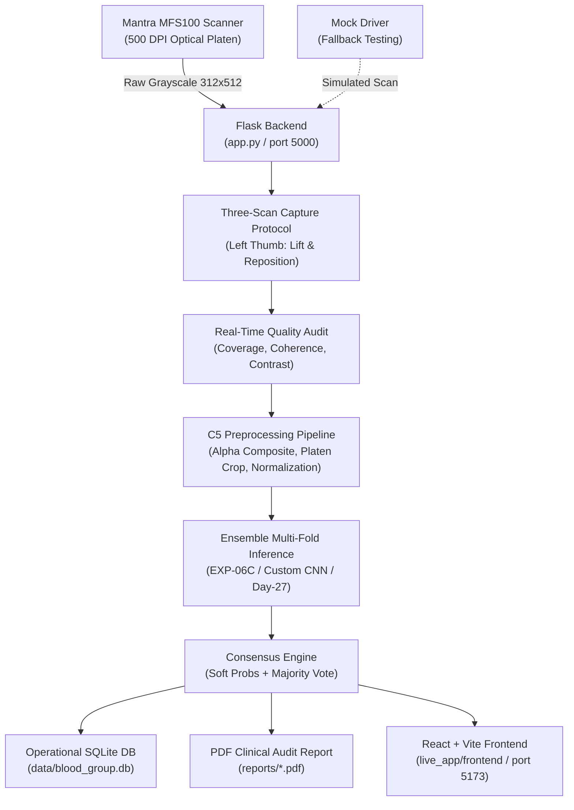

# Teammate Quick-Start & Executive Overview
**Project:** HemoPrint AI — Biometric Blood Group Detection Research System  
**Audience:** Project Teammates, Co-Authors, and Technical Contributors  
**Reading Time:** ~7–10 minutes  
**Document Version:** 1.0 (Audited Scientific Baseline)

---

## 1. Executive Summary: What Is HemoPrint AI?

**HemoPrint AI** is an academic research software platform designed to investigate whether optical fingerprint impressions (acquired via a Mantra MFS100 500 DPI scanner) contain measurable biometric signatures that correlate with human ABO and Rh blood groups.

The system incorporates:
1. **A Full-Stack Research Prototype:** A React + TypeScript web frontend and a Python Flask backend (`app.py`) connected to an operational SQLite database (`data/blood_group.db`).
2. **A Rigorous Biometric Protocol:** A three-scan left-thumb acquisition protocol with real-time platen quality gating (foreground coverage, ridge contrast, and ridge coherence).
3. **An Extensive Machine Learning Lineage:** Ten systematic experimental iterations (EXP-01 through EXP-10) evaluating deep CNN backbones (ResNet-50, DenseNet-121, EfficientNet-B0, VGG16, ConvNeXt), supervised contrastive learning, multi-scan feature concatenation, handcrafted dermatoglyphic ridge features, continuous spatial orientation tensor fields, and quality-weighted multi-scan fusion.

---

## 2. The Core Research Question

> **"Can friction ridge patterns captured from standard optical fingerprint scanners reliably predict human ABO blood groups above chance baseline under strict participant-independent validation?"**

### The Scientific Hypothesis
Dermatoglyphic ridge patterns form during weeks 10–19 of intrauterine embryonic development, roughly concurrent with the developmental period during which primary organogenesis and genetic phenotypic expression occur. Prior literature has hypothesized that pleiotropic genetic factors or common embryonic developmental signals might manifest in both dermatoglyphic pattern configurations (arches, loops, whorls, minutiae density) and erythrocyte membrane surface antigens (ABO/Rh).

---

## 3. The 3 Major Empirical Findings (What the Science Established)

### Takeaway 1: Historical "High Accuracy" (78%–88%) Was Caused by Data Leakage
Early historical experiments in this codebase and literature reported high classification accuracy ($78\%	ext{--}88\%$). Our rigorous audit conclusively demonstrated that **these results were artifacts of scan-level data leakage**—where different scans of the *same participant* were distributed across both training and validation folds. When participants are strictly grouped via `StratifiedGroupKFold` so that no individual's scans appear in both training and test sets, **performance collapses to near-chance levels**.

### Takeaway 2: Deep CNNs Exploited Scanner Platen Illumination, Not Ridges
In deep CNN experiments (EXP-01 through EXP-06D), models achieved apparent development accuracies of $50\%	ext{--}54\%$. However, failure-mode analysis revealed that **scanner platen border brightness and glass reflection intensity correlated with self-reported blood group ($F = 5.996, p = 0.0006$)** because participants with specific blood groups were scanned in distinct temporal batches. When evaluated on out-of-domain cohorts where ambient illumination drifted, accuracy collapsed to $33.33\%$ (below the majority-class baseline).

### Takeaway 3: Friction Ridge Patterns Do Not Encode Detectable ABO Signals
When pure friction-ridge features were isolated (handcrafted minutiae in EXP-08, continuous $920$-d orientation tensor fields with 100% background masking in EXP-09, and multi-scan quality fusion in EXP-10):
* Random Forest achieved $35.0\%	ext{--}40.0\%$ accuracy on the 80-participant development cohort.
* The zero-intelligence majority-class baseline (predicting B+ or O+ for everyone) is **$36.25\%$**.
* Rigorous full-pipeline permutation testing demonstrated that these scores fall well within the null distribution ($p = 0.2537$ in EXP-08; $p = 0.1089$ in EXP-09).
* **Complete minority class blindness:** All models achieved **$0.0\%$ recall on AB+** ($0$ out of $7$ participants detected).

---

## 4. The 4 Critical "Do Nots" for the Research Paper & Final Report

When drafting our conference/journal manuscript and final project submission, teammates **must adhere to these scientific boundaries**:

1. **DO NOT claim high accuracy:** Never cite the obsolete $78\%	ext{--}88\%$ figures as valid results. Present them only in the context of an *ablation analysis showing the danger of scan-level data leakage*.
2. **DO NOT claim clinical validity:** Fingerprint images do not directly measure erythrocyte antigens. The system is strictly an academic research prototype. State clearly that it cannot be used for clinical triage, blood typing, or transfusion decisions.
3. **DO NOT describe the test cohort as "untouched":** The Test-21 cohort was previously evaluated during historical baseline audits; it must be described transparently as a locked secondary evaluation cohort.
4. **DO NOT claim laboratory ground truth:** Labels in the primary cohort (Dev-80) were self-reported via student surveys. Acknowledge this $5\%	ext{--}10\%$ noise ceiling as an empirical limitation.

---

## 5. System Architecture at a Glance

---

## 6. Datasets at a Glance

| Cohort Name | Storage Location | Size / Scans | Classes | Verification | Primary Role |
| :--- | :--- | :---: | :---: | :--- | :--- |
| **Development Cohort (Dev-80)** | `scratch/research_*/` & `data/processed/` | 80 participants (240 scans) | 4 (A+, B+, AB+, O+) | Self-reported survey | Core 5-fold cross-validation development across EXP-01–EXP-10 |
| **Quarantined Test Cohort (Test-21)** | `data/quarantine/` | 21 participants (63 scans) | 4 (A+, B+, AB+, O+) | Self-reported survey | Locked external generalization evaluation (33.3% accuracy) |
| **Hospital Cohort (Hospital-26)** | `data/quarantine/` & `data/mfs100_final/` | 26 participants (78 scans) | 4 (A+, B+, AB+, O+) | Clinical/hospital context | Quarantined clinical validation |
| **Canonical Image Archive** | `dataset_blood_group/` | 6,000 images | 8 classes | Synthetic / Kaggle | Historical pre-training and architecture benchmarking |

---

## 7. Recommended Reading Order for Teammates

To prepare your project report, slides, and research paper without confusion, read the companion documentation in this directory in the following sequence:

1. **[`TEAMMATE_QUICK_START.md`](file:///c:/Users/thanu/OneDrive%20-%20Don%20Bosco%20Institute%20of%20Technology/major%20project/reports/TEAMMATE_PROJECT_REFERENCE/TEAMMATE_QUICK_START.md)** *(This document)* — High-level orientation.
2. **[`RESEARCH_PAPER_PREPARATION_GUIDE.md`](file:///c:/Users/thanu/OneDrive%20-%20Don%20Bosco%20Institute%20of%20Technology/major%20project/reports/TEAMMATE_PROJECT_REFERENCE/RESEARCH_PAPER_PREPARATION_GUIDE.md)** — Recommended titles, outline, tables, figures, and publication phrasing.
3. **[`EXPERIMENTS_AND_RESULTS_REFERENCE.md`](file:///c:/Users/thanu/OneDrive%20-%20Don%20Bosco%20Institute%20of%20Technology/major%20project/reports/TEAMMATE_PROJECT_REFERENCE/EXPERIMENTS_AND_RESULTS_REFERENCE.md)** — Complete numerical tables for EXP-01 through EXP-10, baselines, and discrepancy resolutions.
4. **[`PROJECT_ARCHITECTURE_AND_IMPLEMENTATION.md`](file:///c:/Users/thanu/OneDrive%20-%20Don%20Bosco%20Institute%20of%20Technology/major%20project/reports/TEAMMATE_PROJECT_REFERENCE/PROJECT_ARCHITECTURE_AND_IMPLEMENTATION.md)** — Hardware specifications, API endpoints, SQLite schema, and startup instructions.
5. **[`OPEN_QUESTIONS_AND_UNVERIFIED_CLAIMS.md`](file:///c:/Users/thanu/OneDrive%20-%20Don%20Bosco%20Institute%20of%20Technology/major%20project/reports/TEAMMATE_PROJECT_REFERENCE/OPEN_QUESTIONS_AND_UNVERIFIED_CLAIMS.md)** — Institutional approvals, consent forms, and items teammates must confirm.
6. **[`PROJECT_EVIDENCE_INDEX.csv`](file:///c:/Users/thanu/OneDrive%20-%20Don%20Bosco%20Institute%20of%20Technology/major%20project/reports/TEAMMATE_PROJECT_REFERENCE/PROJECT_EVIDENCE_INDEX.csv)** — Direct mapping connecting every key claim to its exact file and line number.
7. **[`TEAMMATE_MASTER_PROJECT_REFERENCE.md`](file:///c:/Users/thanu/OneDrive%20-%20Don%20Bosco%20Institute%20of%20Technology/major%20project/reports/TEAMMATE_PROJECT_REFERENCE/TEAMMATE_MASTER_PROJECT_REFERENCE.md)** — Exhaustive 30-section technical compendium covering the entire system in full detail.
