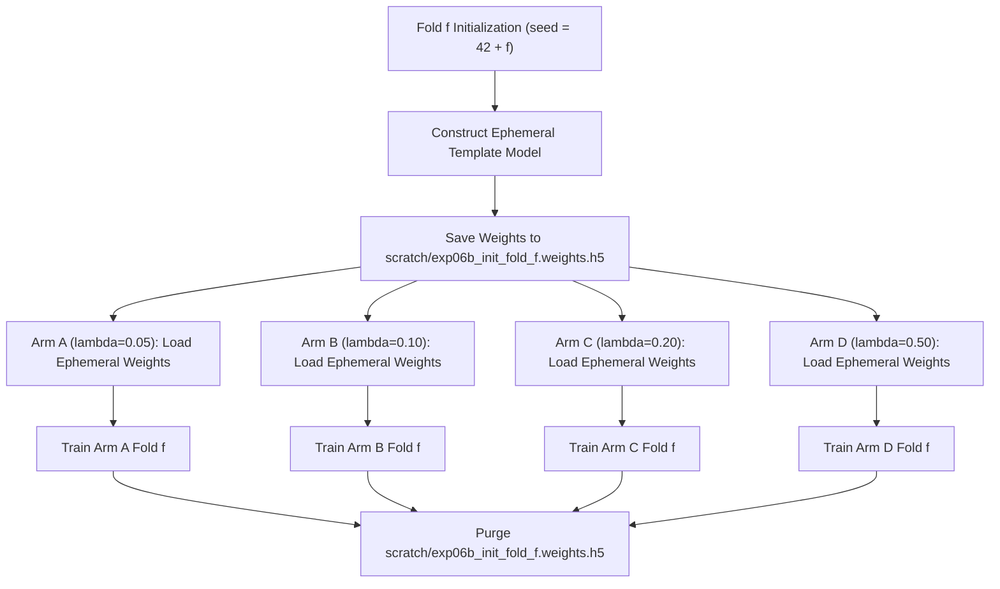

# EXP-06B: Initialization Parity & Parameter Integrity Audit

**Document Version:** 1.0.0  
**Audit Date:** 2026-10-15  
**Experiment Identifier:** `EXP-06B` (Supervised Contrastive Loss Weight Ablation)  
**Lead Auditor:** Senior ML Researcher & Computer Vision Specialist  

---

> [!CAUTION]
> ### RESEARCH USE ONLY — STRICT NON-CLINICAL DISCLAIMER
> This experiment investigates deep learning hyperparameter sensitivity on biometric optical fingerprint representations. All models, weights, metrics, and conclusions documented herein are exploratory academic research prototypes and **must not** be used for clinical diagnostics, transfusion medicine, triage, patient care, or medical blood group determination. Laboratory serological testing is mandatory for all clinical use.

---

## 1. Executive Summary & Purpose

A critical methodological requirement for controlled hyperparameter ablation is **initialization parity**: ensuring that any observed performance difference between experimental arms is caused strictly by the parameter being varied (here, $\lambda_{\text{supcon}}$) and not by random differences in starting weights.

This audit specifies the exact protocol to achieve **100% parameter parity at Epoch 0** across all four arms of EXP-06B.

---

## 2. Model Architecture & Variable Inventory

In EXP-06B, the network architecture is identical across all four arms (Arms A, B, C, D).

### 2.1 Complete Parameter Count Table

| Component / Layer | Layer Type | Output Shape | Total Parameters | Trainable Parameters | Non-Trainable Parameters | Trainable Variable Names |
|:---|:---|:---:|:---:|:---:|:---:|:---|
| **Scan 1 Backbone** | DenseNet-121 (Frozen) | `(None, 1024)` | 7,037,504 | 0 | 7,037,504 | *None (Frozen)* |
| **Scan 2 Backbone** | DenseNet-121 (Frozen) | `(None, 1024)` | — *(shared)* | 0 | — | *None (Frozen)* |
| **Scan 3 Backbone** | DenseNet-121 (Frozen) | `(None, 1024)` | — *(shared)* | 0 | — | *None (Frozen)* |
| **Fusion Neck** | `Concatenate(axis=-1)` | `(None, 3072)` | 0 | 0 | 0 | *None* |
| **Dense 512** | `Dense(512, relu)` | `(None, 512)` | 1,573,376 | 1,573,376 | 0 | `dense_512/kernel:0`, `dense_512/bias:0` |
| **Dropout** | `Dropout(0.5)` | `(None, 512)` | 0 | 0 | 0 | *None* |
| **Classifier Head** | `Dense(4, softmax)` | `(None, 4)` | 2,052 | 2,052 | 0 | `clf/kernel:0`, `clf/bias:0` |
| **Embedding Head** | `Dense(128, linear)` | `(None, 128)` | 393,344 | 393,344 | 0 | `emb/kernel:0`, `emb/bias:0` |
| **Total Model** | | | **9,006,276** | **1,968,772** | **7,037,504** | **Exactly 6 Variables** |

---

## 3. Ephemeral Template Protocol for Epoch-Zero Parity

Because all four arms share the exact same model graph, head initialization must be synchronized across arms within each fold:

### 3.1 Step-by-Step Parity Protocol
1. **Fold Inception ($f \in \{1, 2, 3, 4, 5\}$):**
   - At the beginning of Fold $f$, set pseudo-random seed to `42 + f`.
   - Build an ephemeral instance of the model.
   - Serialize the weights to disk: `scratch/exp06b_init_fold_{f}.weights.h5`.
2. **Arm Loading:**
   - Before beginning training for any arm on Fold $f$, construct the arm's model and immediately call `model.load_weights("scratch/exp06b_init_fold_{f}.weights.h5")`.
   - Verify that all 6 trainable variables match the template bit-for-bit.
3. **Loss & Step-0 Validation:**
   - On a synthetic dummy batch with dropout disabled (`training=False`), verify that the initial classification loss is 100% mathematically identical across Arms A, B, C, D ($\Delta \mathcal{L}_{\text{CE}} = 0.000000$).
4. **Post-Experiment Purge:**
   - Once all four arms have completed all five folds, automatically remove the ephemeral files from `scratch/` to prevent orphaned files.

---

## 4. Protected Checkpoints Audit

To ensure historical continuity and prevent data corruption, all pre-existing model weights are registered and protected.

### 4.1 Protected Historical Checkpoints Inventory

| Checkpoint Name | Relative Path | Expected SHA-256 Checksum | Protection Status |
|:---|:---|:---:|:---:|
| **Production Model** | `models/abo_positive_4class/best_model.keras` | `7b5ff5d94d4ce3de...` | **LOCKED / READ-ONLY** |
| **Orig E2 Fold 1** | `models/phase3_fusion_metric_learning/E2/fold_1_best.weights.h5` | `7d9464d18619a94f...` | **LOCKED / READ-ONLY** |
| **Orig E2 Fold 2** | `models/phase3_fusion_metric_learning/E2/fold_2_best.weights.h5` | `9c72809f23152708...` | **LOCKED / READ-ONLY** |
| **Orig E2 Fold 3** | `models/phase3_fusion_metric_learning/E2/fold_3_best.weights.h5` | `8123b1b86f44719d...` | **LOCKED / READ-ONLY** |
| **Orig E2 Fold 4** | `models/phase3_fusion_metric_learning/E2/fold_4_best.weights.h5` | `cc122b23e0c6d118...` | **LOCKED / READ-ONLY** |
| **Orig E2 Fold 5** | `models/phase3_fusion_metric_learning/E2/fold_5_best.weights.h5` | `aff9e137bed61f64...` | **LOCKED / READ-ONLY** |
| **EXP-03 Arm 1 (Folds 1–5)** | `experiments/exp03/checkpoints/arm1/` | Verified in EXP-06A Audit | **LOCKED / READ-ONLY** |
| **EXP-05 Config A (Folds 1–5)** | `experiments/exp05/checkpoints/config_a/` | Verified in EXP-06A Audit | **LOCKED / READ-ONLY** |
| **EXP-06A (Folds 1–5, All Configs)** | `experiments/exp06a/checkpoints/` | All 20 files verified | **LOCKED / READ-ONLY** |

---

## 5. Audit Conclusion

The initialization parity protocol ensures that:
- Every arm within a fold starts from an identical point in weight space.
- The DenseNet-121 backbone remains strictly frozen.
- All pre-existing production and experimental checkpoints are safeguarded against accidental overwrite.
