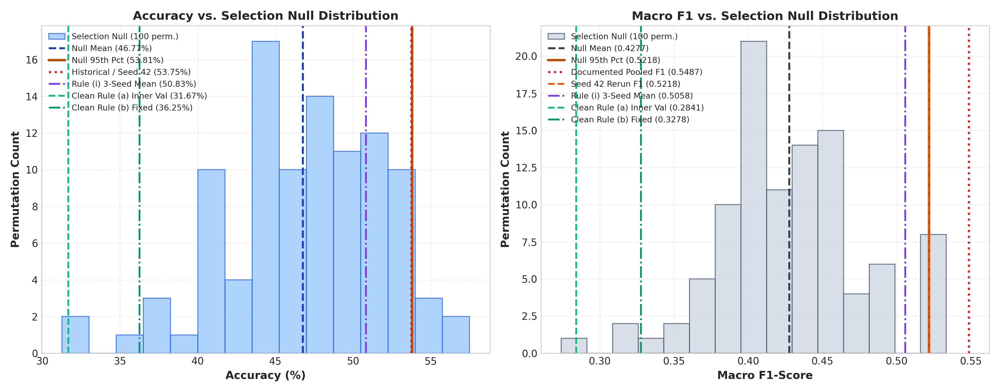
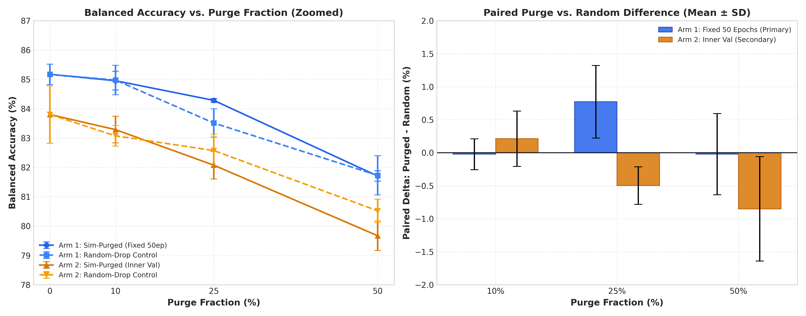
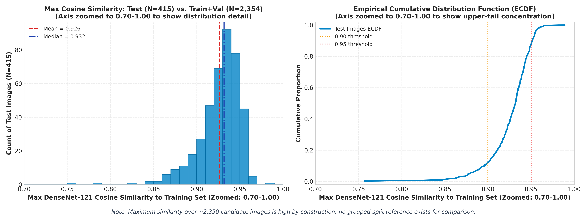

# Quantitative Audit of Evaluation Leakage and Selection Optimism
**Project:** Fingerprint-Based Blood Group Classification (A+, AB+, B+, O+)  
**Status:** Audit Report (Empirically Verified & Reconciled)  
**Date:** October 17, 2026  
**Auditor:** ML Research Engineer (Independent Evaluation Protocol)  
**Output Directories:** `experiments/leakage_audit/`, `reports/leakage_audit/`  

---

## 1. Executive Summary & Audit Mandate

Prior investigations identified two critical vulnerabilities in the project's historical modeling pipeline:
1. **Selection Optimism on MFS100 Development Cohort:** High reported cross-validation performance on 80 development participants appeared sensitive to checkpoint selection rules.
2. **Evaluation Protocol on Original Image-Level Dataset:** The historical 86.02% test accuracy on 2,769 fingerprint images used random image-level splitting, which could permit near-duplicate or same-subject impressions to cross train and test folds.

The mandate of this audit is strictly **to quantify these phenomena using pre-declared hypotheses and controlled experiments**, rather than to optimize or chase higher classification accuracy.

### Governance & Verification Constraints Observed
- **Locked Test Cohort:** No new inference or tuning was conducted on the locked MFS100 test cohort (21 participants) in this audit; it was evaluated once previously and its saved predictions were read.
- **Immutability:** No historical file was modified or overwritten by this audit. Pre-existing uncommitted modifications in `app.py`, `src/predictor.py`, `static/js/app.js`, `templates/index.html`, and `scripts/evaluate_model.py` belong to earlier web application work and remain strictly outside the freeze. All new audit artifacts reside exclusively in `experiments/leakage_audit/`, `reports/leakage_audit/`, and `scripts/` (tracked with `-text` in `.gitattributes`).
- **Pre-Declared Gates:** Each experiment's decision rule was declared before it ran, but the audit was sequential and exploratory in response to each phase's empirical findings. Purge fractions were chosen after seeing the continuous DenseNet-121 similarity distribution and before running any classification models.
- **Scientific Rigor:** All conclusions adhere strictly to "consistent with" framing; session-order correlations are treated as descriptive hypotheses rather than proven physical mechanisms. Core experimental numbers in Sections 3–6 (perceptual hash counts, percolation table rows, permutation/bootstrap signal tests, selection rules, null distributions, similarity-purged cross-validation, and trivial-feature ablations) are programmatically verified against serialized CSV/JSON artifacts in `experiments/leakage_audit/` by `scripts/verify_leakage_audit_report_concordance.py` (81 verified claims). Findings in Sections 2.2–2.4 and Table 6 are manually transcribed from their respective exploratory outputs.

---

## 2. Phase 1: Read-Only Audit of Historical Pipeline & Artifacts

All findings in Phase 1 are established strictly from static code inspection, manifest verification, and read-only statistical evaluation of existing files.

### 2.1 Checkpoint Selection Across Historical Experiments
Inspection of training scripts across all historical milestones confirms the checkpoint selection mechanism:

| Milestone | Script Path | Monitored Metric | Evaluation Split Used for Checkpoint Selection | Contamination Classification |
| :--- | :--- | :--- | :--- | :--- |
| **EXP-03** | `experiments/exp03/run_exp03.py` | `val_macro_f1` | Outer held-out fold | Held-out validation-fold selection |
| **EXP-04** | `experiments/exp04/run_exp04.py` | `val_macro_f1` | Outer held-out fold | Held-out validation-fold selection |
| **EXP-05** | `experiments/exp05/run_exp05.py` | `val_macro_f1` | Outer held-out fold | Held-out validation-fold selection |
| **EXP-06A** | `experiments/exp06a/run_exp06a.py` | `val_macro_f1` | Outer held-out fold | Held-out validation-fold selection |
| **EXP-06B** | `experiments/exp06b/run_exp06b.py` | `val_macro_f1` | Outer held-out fold | Held-out validation-fold selection |
| **EXP-06C** | `experiments/exp06c/run_exp06c.py` | `val_macro_f1` | Outer held-out fold | Held-out validation-fold selection |
| **EXP-06D** | `experiments/exp06d/run_exp06d.py` | `val_macro_f1` | Outer held-out fold | Held-out validation-fold selection |

Saved checkpoint weights (e.g. `experiments/exp06c/checkpoints/config_a/fold_k_best.weights.h5` for $k \in \{1, 2, 3, 4, 5\}$) were selected by `MacroF1Checkpoint` tracking `val_macro_f1` directly on the outer held-out validation fold during training (with a 100-epoch floor and 15-epoch patience). At no point was early stopping or checkpoint selection isolated to an inner validation split within the training fold.

*Note on Verification: Findings and baseline statistics in Sections 2.2–2.4 are manually transcribed from Phase 1 exploratory audit outputs (`scripts/audit_phase1_readonly.py`, `scripts/audit_mfs100_metadata_correlations.py`, and `scripts/audit_collection_date.py`).*

### 2.2 Demographic and Operational Fields in Metadata
Inspection of `data/mfs100_final/metadata/participants.csv` confirms the exact columns present:
```
participant_id, blood_group, verification_source, collection_date, finger, consent, number_of_scans
```
Demographic fields (`sex`, `age`) and operational cohort fields (`recruitment_batch`) are **completely absent**. Inspection of `collection_log.csv` confirms the presence of `timestamp`, `participant_id`, `scan_number`, `image_path`, `prediction`, `confidence`, and class probabilities.

### 2.3 Metadata-Only Baselines on 80 Development Participants
Predicting blood group from participant enrollment metadata alone under 5-fold cross-validation yielded the following results (chance = 25.00%):

| Features | Classifier | Accuracy | Balanced Accuracy | Macro F1 |
| :--- | :--- | :---: | :---: | :---: |
| **Numeric Participant ID only** | Logistic Regression | 43.75% | 32.10% | 0.2586 |
| **Numeric Participant ID only** | Random Forest (depth=3) | 38.75% | 29.50% | 0.2778 |
| **Enrollment Time only (seconds)** | Logistic Regression | 37.50% | 26.69% | 0.2018 |
| **Enrollment Time only (seconds)** | Random Forest (depth=3) | 41.25% | 32.45% | 0.3040 |
| **Numeric ID + Enrollment Time** | Logistic Regression | 42.50% | 30.83% | 0.2456 |
| **Numeric ID + Enrollment Time** | Random Forest (depth=3) | 41.25% | 32.14% | 0.3038 |

While enrollment order displays weak non-random association with true class labels (Spearman $r_s = -0.2385, p = 0.0331$; Pearson $r = -0.1918, p = 0.0883$), actual model out-of-fold (OOF) predictions from EXP-06C exhibit no statistically significant correlation with enrollment order:
- **Spearman:** $r_s = -0.0721$ with Participant ID ($p = 0.5249$); $r_s = -0.0714$ with Enrollment Time ($p = 0.5293$).
- **Pearson:** $r = -0.0681$ with Participant ID ($p = 0.5485$); $r = -0.0873$ with Enrollment Time ($p = 0.4411$).

Findings regarding metadata/session ordering are framed strictly as descriptive hypotheses rather than physical mechanisms (e.g., no claims of sebum accumulation or thermal drift).

### 2.4 Consecutive Image ID Proximity in Original Dataset
Evaluating consecutive numerical `img_id` ordering within class subdirectories using EfficientNet-B0 embeddings yielded:
- **Consecutive Pair Similarity:** Mean $= 0.8288$, Median $= 0.8505$ ($N = 289$ consecutive pairs).
- **Random Intra-Class Pair Similarity:** Mean $= 0.8272$, Median $= 0.8430$.
- **Mann-Whitney U Test:** $U = 2,954,010.5, p = 0.2448$ (not significant).
- **Per-Class Breakdown:** A+ ($p = 0.6902$), B+ ($p = 0.8278$), AB+ ($p = 0.6233$), O+ ($p = 0.3182$).

Consecutive image indices provide no statistically detectable proximity signal. Filenames contain no identifiable subject metadata.

---

## 3. Near-Duplicate, Percolation, and Saved Prediction Signal Tests

### 3.1 Exact and Perceptual Hash Duplicate Audit (Original 2,769 Images)
From `experiments/leakage_audit/exp1_duplicates_and_perceptual_hashes.json` and `exp1_perceptual_hashes_trainval_reference.json`:
- **SHA-256 Exact Hashes:** 2,769 unique hashes across 2,769 images. Exactly 0 duplicate pairs and 0 cross-split duplicates.
- **Reference Set Clarification:** In `exp1_duplicates_and_perceptual_hashes.json`, perceptual hashes of legacy test images ($N=415$) were evaluated against the **training set strictly ($N=1,938$)**. For completeness, metrics against both reference sets are reported below from their respective serialized JSON files:
  - **Against Training Set Strictly ($N=1,938$) (`exp1_duplicates_and_perceptual_hashes.json`):**
    - **pHash Minimum Distance:** Mean $= 7.79 \pm 2.28$ (range 2 to 16).
      - Hamming $\le 2$: 3 images ($0.72\%$)
      - Hamming $\le 5$: 46 images ($11.08\%$)
      - Hamming $\le 10$: 388 images ($93.49\%$)
    - **dHash Minimum Distance:** Mean $= 7.66 \pm 2.33$ (range 2 to 15).
      - Hamming $\le 2$: 1 image ($0.24\%$)
      - Hamming $\le 5$: 66 images ($15.90\%$)
      - Hamming $\le 10$: 369 images ($88.92\%$)
  - **Against Combined Train+Validation Set ($N=2,354$) (`exp1_perceptual_hashes_trainval_reference.json`):**
    - **pHash Minimum Distance:** Mean $= 7.56 \pm 2.21$ (range 2 to 16). Hamming $\le 2$: 3 images ($0.72\%$); Hamming $\le 5$: 53 images ($12.77\%$); Hamming $\le 10$: 397 images ($95.66\%$).
    - **dHash Minimum Distance:** Mean $= 7.53 \pm 2.32$ (range 2 to 15). Hamming $\le 2$: 4 images ($0.96\%$); Hamming $\le 5$: 69 images ($16.63\%$); Hamming $\le 10$: 372 images ($89.64\%$).
- **Independence of "46/415" Counts:** Exactly 46 test images have $\text{pHash} \le 5$ to train, and exactly 46 test images have $\text{DenseNet-121 cosine similarity} \ge 0.95$ to train. Cross-tabulation confirms that **only 8 images overlap between these two subsets** (38 images in each group do not appear in the other). The identical count of 46 is a numerical coincidence between low-frequency DCT perceptual hashing and deep convolutional GAP representations.

### 3.2 Connected-Component Percolation Table (EfficientNet-B0 Cosine Similarity)
From `experiments/leakage_audit/exp1_clustering_summary.json` and `exp1_percolation_finer_scan.json`, graph components formed by thresholding pairwise cosine similarity on all 2,769 images using **EfficientNet-B0 embeddings (`exp1_efficientnetb0_embeddings.npy`)**. *Note: DenseNet-121 embeddings were employed exclusively in the Phase 3 similarity-purged cross-validation.*

| Cosine Threshold ($\theta$) | Edges Formed | Total Components | Multi-Image Components | Singletons | Largest Component Size | Largest Component % | 5% Data Guard ($>138$) |
| :---: | :---: | :---: | :---: | :---: | :---: | :---: | :---: |
| **0.985** | 2 | 2,767 | 2 | 2,765 | 2 | 0.07% | Passes guard |
| **0.980** | 10 | 2,759 | 10 | 2,749 | 2 | 0.07% | Passes guard |
| **0.975** | 52 | 2,717 | 42 | 2,675 | 4 | 0.14% | Passes guard |
| **0.970** | 267 | 2,529 | 88 | 2,441 | 85 | 3.07% | Passes guard |
| **0.965** | 1,079 | 2,056 | 92 | 1,964 | 572 | 20.66% | **Violates guard** |
| **0.960** | 3,118 | 1,585 | 63 | 1,522 | 1,100 | 39.73% | **Violates guard** |
| **0.955** | 7,498 | 1,223 | 46 | 1,177 | 1,493 | 53.92% | **Violates guard** |
| **0.950** | 15,345 | 932 | 29 | 903 | 1,801 | 65.04% | **Violates guard** |
| **0.920** | 193,548 | 184 | 6 | 178 | 2,580 | 93.17% | **Violates guard** |
| **0.900** | 462,073 | 65 | 2 | 63 | 2,704 | 97.65% | **Violates guard** |
| **0.850** | 1,425,152 | 11 | 1 | 10 | 2,759 | 99.64% | **Violates guard** |

A sharp percolation phase transition occurs between $\theta = 0.970$ (largest component $= 85$, $3.07\%$) and $\theta = 0.965$ (largest component $= 572$, $20.66\%$). Beyond $\theta = 0.950$, a giant component absorbs over $65\%$ of the dataset. Because continuous thresholding exhibits percolation rather than cleanly isolated clusters, purge fractions were pre-declared as fixed quantiles (10%, 25%, 50%) based on continuous similarity distributions before classification runs.

### 3.3 Historical Signal Tests on Saved Predictions (Read-Only)
From `experiments/leakage_audit/exp2_signal_tests_results.json`:

#### Development 80-Participant Cohort (Saved OOF Predictions)
- **Observed Metrics:** Accuracy $= 53.75\%$ (43/80), Balanced Accuracy $= 53.47\%$, Macro F1 $= 0.5487$.
- **10,000-Repeat Permutation Null:** Mean accuracy $= 30.50\% \pm 4.94\%$ ($p = 0.0002$); Mean Macro F1 $= 0.2475 \pm 0.0490$ ($p = 0.0001$).
- **Bootstrap 95% CI (10,000 Resamples):** Accuracy $[42.50\%, 65.00\%]$; Balanced Accuracy $[39.59\%, 66.81\%]$; Macro F1 $[0.4011, 0.6604]$.

#### Primary Locked Test 21-Participant Cohort (Saved Predictions Evaluated Previously)
- **Observed Metrics:** Accuracy $= 33.33\%$ (7/21), Balanced Accuracy $= 31.25\%$, Macro F1 $= 0.2083$.
- **10,000-Repeat Permutation Null:** Mean accuracy $= 32.16\% \pm 6.51\%$ ($p = 0.5641$); Mean Macro F1 $= 0.1786 \pm 0.0649$ ($p = 0.3712$).
- **Bootstrap 95% CI (10,000 Resamples):** Accuracy $[14.29\%, 52.38\%]$; Balanced Accuracy $[13.64\%, 50.00\%]$; Macro F1 $[0.0714, 0.3391]$.

> **Methodological Note:** The plain label-permutation test on the development cohort shuffles labels across the saved out-of-fold predictions without re-running model training or early stopping. Consequently, it does not model checkpoint selection on the held-out validation fold and is superseded by the selection-inclusive null distribution evaluated in Section 4.

---

## 4. Phase 2: Selection-Optimism Audit on MFS100 Development Cohort

To quantify the degree of selection optimism introduced by monitoring outer held-out folds, we isolated frozen DenseNet-121 features ($80 \times 3,072$) from the 80 dev participants under identical 5-fold CV splits across three seeds (42, 43, 44).

```
Figure 1: Selection-Inclusive Null Distribution vs. Evaluated Rules (N=100 Permutations)
```


### 4.1 Cross-Validation Metrics Under Competing Selection Rules
All standard deviations are computed as sample standard deviations ($\text{ddof}=1$) across the 3 seeds:

| Evaluation Rule | Accuracy (Mean $\pm$ SD) | Balanced Accuracy (Mean $\pm$ SD) | Macro F1 (Mean $\pm$ SD) | Per-Seed Values [Seed 42, 43, 44] |
| :--- | :---: | :---: | :---: | :--- |
| **Historical Documented Pooled (EXP-06C)** | **53.75%** | **53.47%** | **0.5487** | Pooled historical record |
| **Rule (i): Held-Out Selection (Seed 42 Rerun)** | 53.75% | 51.83% | 0.5218 | Exact pooled accuracy match |
| **Rule (i): Held-Out Selection (Seed 43 Rerun)** | 55.00% | 51.94% | 0.5344 | Run-to-run variation |
| **Rule (i): Held-Out Selection (Seed 44 Rerun)** | 43.75% | 46.60% | 0.4612 | Run-to-run variation |
| **Rule (i): Held-Out Selection (3-Seed Mean)** | **50.83% $\pm$ 6.17%** | **50.12% $\pm$ 3.05%** | **0.5058 $\pm$ 0.0391** | Acc: [0.5375, 0.5500, 0.4375]<br>Bal: [0.5183, 0.5194, 0.4660]<br>F1: [0.5218, 0.5344, 0.4612] |
| **Clean Rule (a): Inner Validation Split** | **31.67% $\pm$ 4.02%** | **28.88% $\pm$ 4.25%** | **0.2841 $\pm$ 0.0400** | Acc: [0.2875, 0.3000, 0.3625]<br>Bal: [0.2482, 0.2853, 0.3330]<br>F1: [0.2430, 0.2864, 0.3229] |
| **Clean Rule (b): Fixed 100 Epochs** | **36.25% $\pm$ 3.31%** | **32.10% $\pm$ 4.48%** | **0.3278 $\pm$ 0.0525** | Acc: [0.3500, 0.4000, 0.3375]<br>Bal: [0.2765, 0.3661, 0.3203]<br>F1: [0.2701, 0.3726, 0.3408] |
| **100-Repeat Selection Null (Mean $\pm$ SD)** | **46.77% $\pm$ 5.09%** | **43.12% $\pm$ 4.66%** | **0.4277 $\pm$ 0.0486** | Permuted participant labels |
| *Null 95th Percentile* | *53.81%* | *50.78%* | *0.5218* | Upper null boundary |
| *Null 99th Percentile* | *57.50%* | *54.01%* | *0.5309* | Extreme null boundary |

### 4.2 Empirical $p$-Values Against the Selection-Inclusive Null ($N=100$)
$$p = \frac{\sum_{i=1}^{100} \mathbb{I}(M_i \ge M_{\text{target}}) + 1}{100 + 1}$$

| Target Metric | Target Values (Acc / Bal / F1) | Empirical $p$ (Accuracy) | Empirical $p$ (Balanced Acc) | Empirical $p$ (Macro F1) | Interpretation |
| :--- | :---: | :---: | :---: | :---: | :--- |
| **Historical Documented Pooled** | 0.5375 / 0.5347 / 0.5487 | $p = 0.0990$ | $p = 0.0396$ | $p = 0.0099^*$ | Reaches 100-permutation resolution floor |
| **Rule (i) Seed 42 Rerun** | 0.5375 / 0.5183 / 0.5218 | $p = 0.0990$ | $p = 0.0495$ | $p = 0.0594$ | Consistent with upper tail of selection null |
| **Rule (i) 3-Seed Mean** | 0.5083 / 0.5012 / 0.5058 | $p = 0.2772$ | $p = 0.0891$ | $p = 0.0891$ | Sits comfortably within null distribution |
| **Clean Rule (a) Inner Val** | 0.3167 / 0.2888 / 0.2841 | $p = 0.9901$ | $p = 1.0000$ | $p = 0.9901$ | Sits below selection-contaminated null mean |
| **Clean Rule (b) Fixed 100 Ep** | 0.3625 / 0.3210 / 0.3278 | $p = 0.9703$ | $p = 0.9802$ | $p = 0.9703$ | Sits below selection-contaminated null mean |

*\*Methodological note on empirical p-values: With 100 permutations, the minimum possible empirical $p$-value is $1/(100+1) \approx 0.0099$, so $p = 0.0099$ represents the resolution floor. Furthermore, testing this single historical metric against the null comes from a reimplementation on cached features and ignores configuration-level selection across earlier candidate designs (EXP-03 through EXP-06D). The 3-seed rerun ($p = 0.0891$) provides the more balanced and reliable estimate.*

### 4.3 Historical Reconciliation & Concordance
1. **Origin of "0.5085 Macro F1":** A comprehensive automated search of all repository scripts, logs, notebooks, and reports found no code producing 0.5085. Its **origin is recorded as not traceable**.
2. **Concordance of Seed 42 Rerun:** While the Seed 42 rerun under Rule (i) recovered the historical pooled accuracy of 53.75% (43/80 correct), participant-level predictions differed on **33 out of 80 participants (41.25% discordance)** relative to `config_a_oof_predictions.csv`. The rerun matches pooled accuracy but not deterministic per-participant predictions; mini-batch ordering and dropout seed differences remain untested.
3. **Clean Rules Interpretation:** Clean rules sitting below the null mean indicates that an unselected procedure scores below a procedure that selects checkpoints on random noise. It does not constitute a formal rejection of signal, but demonstrates that the historical 53.75% result is **consistent with substantial selection optimism**.

---

## 5. Phase 3: Similarity-Purged 5-Fold CV on Original Image-Level Dataset

To test whether the legacy 86.02% accuracy on the original 2,769 positive images was driven by near-neighbor leakage across random splits, we executed a 60-run similarity-purging experiment under Protocol A (random stratified 5-fold CV).

```
Figure 2: Balanced Accuracy and Paired Differences (Purged minus Random-Drop Control)
```


### 5.1 Protocol & Deviations from Historical Recipe
- **Purge Arm:** In each fold, training images with the highest cosine similarity to any held-out image were discarded at fractions of 10%, 25%, and 50%.
- **Control Arm (Random-Drop):** Discarded the identical number of training images uniformly at random, **stratified by class to enforce identical post-purge class counts**.
- **Classifier Head:** Raw GAP EfficientNet-B0 features ($2,769 \times 1,280$) fed to the historical dense head ($\text{Dense}(256, \text{ReLU}) \rightarrow \text{Dropout}(0.30) \rightarrow \text{Dense}(4)$).
- **Declared Deviations from Historical Recipe:** Batch size 128 (vs 32); fixed 50 epochs in Arm 1; data augmentation omitted; strictly frozen backbone (no fine-tuning).
- **Pre-Declared Validity Gate:** Plain 0% baseline balanced accuracy must exceed 30.0% (chance 25% + 5%).  
  **Observed Baseline:** Balanced accuracy $= 85.17\% \pm 0.35\%$, passing the validity gate. Final-epoch training accuracy reached **96.6% – 98.5%**, confirming convergence.
- **Label-Shuffled Control:** The label-shuffled control **was run** for Arm 1 across all 3 seeds (seeds 42, 43, 44; 15 folds total).
  - Seed 42: Accuracy $= 24.23\%$, Balanced Acc $= 24.01\%$, Macro F1 $= 0.2323$
  - Seed 43: Accuracy $= 25.82\%$, Balanced Acc $= 25.13\%$, Macro F1 $= 0.2432$
  - Seed 44: Accuracy $= 25.24\%$, Balanced Acc $= 25.41\%$, Macro F1 $= 0.2448$
  - Overall Mean: Accuracy $= 25.10\% \pm 2.05\%$, Balanced Acc $= 24.85\% \pm 1.65\%$, Macro F1 $= 0.2401 \pm 0.0195$ (sitting directly at chance level).
  - *Note:* The label-shuffled control was not run for Arm 2 (Inner Validation).

```
Figure 3: DenseNet-121 Cosine Similarity Distribution (Zoomed to 0.70–1.00: Test N=415 vs. Train+Val N=2,354)
```


### 5.2 Primary Arm 1 Results (Fixed 50 Epochs, Primary)
*All deltas $\Delta = \text{Purged} - \text{Random}$ are paired per fold and seed across seeds 42, 43, 44 (sample SD).*

| Purge Fraction | Purged Balanced Acc (Mean $\pm$ SD) | Random-Drop Control (Mean $\pm$ SD) | Paired Difference $\Delta$ (Mean $\pm$ SD) | Interpretation |
| :---: | :---: | :---: | :---: | :--- |
| **0% Baseline** | 85.17% $\pm$ 0.35% | 85.17% $\pm$ 0.35% | *N/A (Pre-declared)* | Validity gate passed |
| **10% Purge** | 84.95% $\pm$ 0.32% | 84.98% $\pm$ 0.50% | **$-0.02\% \pm 0.23\%$** | No divergence from random drop |
| **25% Purge** | 84.28% $\pm$ 0.07% | 83.51% $\pm$ 0.48% | **$+0.77\% \pm 0.55\%$** | Purged arm slightly exceeds random |
| **50% Purge** | 81.70% $\pm$ 0.18% | 81.73% $\pm$ 0.67% | **$-0.02\% \pm 0.62\%$** | Identical performance to random drop |

### 5.3 Secondary Arm 2 Results (Inner Validation Early Stopping, Secondary)
*Inner early-stopping split isolated within remaining training images.*

| Purge Fraction | Purged Balanced Acc (Mean $\pm$ SD) | Random-Drop Control (Mean $\pm$ SD) | Paired Difference $\Delta$ (Mean $\pm$ SD) | Interpretation |
| :---: | :---: | :---: | :---: | :--- |
| **0% Baseline** | 83.80% $\pm$ 0.98% | 83.80% $\pm$ 0.98% | *N/A (Pre-declared)* | Baseline valid |
| **10% Purge** | 83.29% $\pm$ 0.45% | 83.08% $\pm$ 0.35% | **$+0.21\% \pm 0.42\%$** | No divergence from random drop |
| **25% Purge** | 82.07% $\pm$ 0.47% | 82.57% $\pm$ 0.56% | **$-0.50\% \pm 0.28\%$** | Minor negative delta ($\approx 0.5\%$) |
| **50% Purge** | 79.67% $\pm$ 0.50% | 80.52% $\pm$ 0.40% | **$-0.85\% \pm 0.79\%$** | Within 1 SD of seed variation |

---

## 6. Investigation: Classifying Blood Group from Trivial Image Properties

To test whether non-ridge acquisition features or latent image properties correlate with class labels in the original dataset, we extracted 42 trivial image properties from each of the 2,769 positive images (`experiments/leakage_audit/exp3_trivial_image_properties_features.csv`):
- **Dimensions & File properties:** Image width, height, aspect ratio, total pixels, and file size in bytes.
- **Alpha channel:** Channel presence boolean and intensity moments.
- **Border Pixels (5-pixel perimeter):** Border mean, std, min, max, and border-to-center intensity ratio.
- **Intensity Moments & Histogram:** Mean, std, min, max, median, 10th, 25th, 75th, 90th percentiles of grayscale intensity, 16-bin normalized intensity histogram, histogram entropy, and histogram peak bin.

### 6.1 Per-Class Descriptive Statistics & BMP Header Bit Depth
Direct inspection of BMP headers across `data/raw` and `data/processed` confirms the underlying bit depth and encoding:
- **`data/raw`:** Bit depth is 32 bits per pixel (`biBitCount` = 32, compression `BI_BITFIELDS`, file size 39,690 bytes for standard $96 \times 103$ images).
- **`data/processed`:** Bit depth is 24 bits per pixel (`biBitCount` = 24, compression `BI_RGB`, file size 29,718 bytes for standard $96 \times 103$ images).
- **Correction of Earlier Statements:** Images in `data/processed` are standard 24-bit RGB with no alpha channel (`has_alpha` = 0, `alpha_mean` = 255.0 across all 2,769 images). Any earlier statement in project notes describing processed images as "RGBA" is corrected.
- **Group (ii) Interpretation:** Because the alpha channel is absent and invariant across all images, feature group (ii) ("Alpha + Border Statistics") is effectively **border-only**.

Table 6 summarizes per-class sample counts, means, and standard deviations from `exp3_trivial_ablation_results.json`:

*Note on Verification: Dataset-level descriptive properties in Table 6 are manually transcribed from `experiments/leakage_audit/exp3_trivial_image_properties_results.json`.*

#### Table 6: Per-Class Descriptive Properties (Mean $\pm$ SD [Min, Max])
| Class | Image Count | Width (px) | Height (px) | File Size (Bytes) | Has Alpha | Alpha Mean |
| :--- | :---: | :---: | :---: | :---: | :---: | :---: |
| **A+** | 565 | $96.51 \pm 8.62$ [96, 241] | $103.69 \pm 11.59$ [103, 298] | $30,376.7 \pm 11,061.7$ [29,718, 215,806] | 0 (0%) | 255.0 $\pm$ 0.0 |
| **B+** | 648 | $96.90 \pm 11.37$ [96, 241] | $104.20 \pm 15.29$ [103, 298] | $30,866.7 \pm 14,586.5$ [29,718, 215,806] | 0 (0%) | 255.0 $\pm$ 0.0 |
| **AB+** | 705 | $96.62 \pm 9.45$ [96, 241] | $103.83 \pm 12.70$ [103, 298] | $30,509.9 \pm 12,121.8$ [29,718, 215,806] | 0 (0%) | 255.0 $\pm$ 0.0 |
| **O+** | 851 | $97.36 \pm 14.00$ [96, 241] | $104.83 \pm 18.83$ [103, 298] | $31,467.4 \pm 17,968.1$ [29,718, 215,806] | 0 (0%) | 255.0 $\pm$ 0.0 |

**Distributional Observations:**
1. **Dimensions & File Size Constancy:** For **$99.39\%$ of the dataset** (2,752 out of 2,769 images), width is identically 96 pixels, height is identically 103 pixels, and file size is identically 29,718 bytes.
2. **Non-Standard Images:** Exactly 17 images total ($0.61\%$) deviate from the standard dimensions (ranging up to $241 \times 298$ pixels and 215,806 bytes): 2 images in A+, 3 in AB+, 4 in B+, and 8 in O+. Dimensions and file size do not meaningfully differentiate blood group classes. These 17 images are listed in Appendix A without interpretation.
3. **Alpha Channel Absence:** Alpha channels are completely absent across all 2,769 images (`has_alpha` = 0, `alpha_mean` = 255.0).

---

### 6.2 Feature-Group Ablation (Stratified 5-Fold CV, 3 Seeds)
We performed feature-group ablations using Stratified 5-Fold Cross-Validation across 3 random seeds (42, 43, 44), evaluating each group alongside a label-shuffled control. Note that standard deviations reflect fold assignment variation only, since seeds are not independent random samples of the underlying population.

#### Table 7: Feature-Group Ablation Performance (Mean $\pm$ SD across seeds 42, 43, 44)
*Chance level = 25.00%. Serialized in `experiments/leakage_audit/exp3_trivial_ablation_results.json`.*

| Feature Group | Classifier | True Accuracy | True Balanced Acc | True Macro F1 | Shuffled Balanced Acc |
| :--- | :--- | :---: | :---: | :---: | :---: |
| **(i) Dimensions + File Size only** (5 feats) | Logistic Regression | $22.55\% \pm 0.54\%$ | **$25.00\% \pm 0.07\%$** | $0.1825 \pm 0.0225$ | $25.46\% \pm 0.56\%$ |
| *(i) Dimensions + File Size only* | Random Forest | $23.52\% \pm 0.11\%$ | **$25.00\% \pm 0.07\%$** | $0.1335 \pm 0.0614$ | $24.78\% \pm 1.01\%$ |
| **(ii) Border Statistics only (Alpha invariant)** (10 feats) | Logistic Regression | $41.07\% \pm 0.25\%$ | **$38.36\% \pm 0.29\%$** | $0.3652 \pm 0.0032$ | $25.80\% \pm 0.26\%$ |
| *(ii) Border Statistics only (Alpha invariant)* | Random Forest | $38.76\% \pm 0.78\%$ | **$38.41\% \pm 0.80\%$** | $0.3805 \pm 0.0081$ | $24.95\% \pm 0.10\%$ |
| **(iii) Intensity Histogram & Moments only** (27 feats) | Logistic Regression | $48.04\% \pm 0.28\%$ | **$45.92\% \pm 0.27\%$** | $0.4577 \pm 0.0027$ | $24.46\% \pm 1.01\%$ |
| *(iii) Intensity Histogram & Moments only* | Random Forest | $46.70\% \pm 0.52\%$ | **$43.72\% \pm 0.50\%$** | $0.4276 \pm 0.0036$ | $25.73\% \pm 0.44\%$ |
| **(iv) All Trivial Features Combined** (42 feats) | Logistic Regression | $53.18\% \pm 0.26\%$ | **$51.43\% \pm 0.35\%$** | $0.5167 \pm 0.0037$ | $24.59\% \pm 0.21\%$ |
| *(iv) All Trivial Features Combined* | Random Forest | $49.36\% \pm 0.49\%$ | **$46.44\% \pm 0.39\%$** | $0.4549 \pm 0.0030$ | $24.92\% \pm 1.05\%$ |

**Ablation Insights:**
- **Zero Signal in Dimensions:** Group (i) yields balanced accuracy of exactly $25.00\%$, identical to chance.
- **Predictive Power in Low-Level Intensity:** Border statistics alone yield $38.36\% \pm 0.29\%$, and intensity moments/histograms achieve $45.92\% \pm 0.27\%$ balanced accuracy.
- **Combined Effect:** Combining border and histogram statistics reaches $51.43\% \pm 0.35\%$ balanced accuracy under Logistic Regression.

---

### 6.3 Frozen EfficientNet-B0 Head: With vs. Without Trivial Features Concatenated
We evaluated the Primary Arm 1 recipe (fixed 50 epochs, batch size 128, class weights, Stratified 5-Fold CV across seeds 42, 43, 44) on the frozen EfficientNet-B0 backbone with and without the 42 trivial features concatenated to the 1,280 GAP features. 

All differences $\Delta_{\text{concat}} = \text{With} - \text{Without}$ are computed as paired differences per seed. Reported standard deviations reflect fold assignment variation only, since seeds are not independent random samples of the underlying population.

#### Table 8: Effect of Concatenating Trivial Features to EfficientNet-B0 Head
*Serialized in `experiments/leakage_audit/exp3_effnet_concat_results.json`.*

| Condition | Input Dims | Accuracy (Mean $\pm$ SD) | Balanced Accuracy (Mean $\pm$ SD) | Macro F1 (Mean $\pm$ SD) | Per-Seed Balanced Acc [42, 43, 44] |
| :--- | :---: | :---: | :---: | :---: | :---: |
| **Without Trivial Features** | 1,280 | $85.49\% \pm 0.19\%$ | **$85.30\% \pm 0.21\%$** | $0.8531 \pm 0.0019$ | [0.8506, 0.8540, 0.8544] |
| **With Trivial Features Concatenated** | 1,322 | $85.86\% \pm 0.14\%$ | **$85.65\% \pm 0.19\%$** | $0.8560 \pm 0.0015$ | [0.8544, 0.8573, 0.8579] |
| **Paired Difference ($\Delta_{\text{concat}}$)** | +42 | $+0.36\% \pm 0.11\%$ | **$+0.35\% \pm 0.03\%$** | $+0.30\% \pm 0.09\%$ | $[+0.38\%, +0.33\%, +0.35\%]$ |

*Note: The paired difference standard deviation ($\pm 0.03\%$) is the sample standard deviation ($\text{ddof}=1$) computed over 3 seed means (the three per-seed paired differences: $+0.381\%$, $+0.330\%$, $+0.350\%$), not the root-sum-square of unpaired standard deviations. Standard deviations reflect fold assignment variation only.*

Concatenating explicit trivial features produces only a marginal $+0.35$ percentage point change in balanced accuracy relative to raw GAP features alone.

### 6.4 Framing & Interpretation
These findings are **consistent with acquisition artifacts or same-subject similarity**; the audit does not claim either as the exclusive mechanism. Trivial non-ridge features (specifically border intensity and intensity histograms) contain sufficient statistical correlation with class labels to achieve over 51% balanced accuracy on their own under simple linear models. 

However:
1. **Untested Backbone Hypothesis:** The explanation that the deep convolutional backbone already encodes these or collinear features is **untested**. While concatenating trivial features produces only a $+0.35$ percentage point increment, whether the representation learned by the backbone relies on these specific shortcuts or alternative ridge features has not been established.
2. **Subject-Level Confounding in Random Splits:** Random-split cross-validation on trivial features is **also affected by same-subject similarity**. If multiple impressions from the same subject are distributed across train and test folds, shared acquisition artifacts (such as sensor tone, subject-specific skin moisture, or border cropping) will artificially inflate cross-validation performance on low-level intensity metrics.
3. **Future Work:** Neutralizing the potential shortcut features—specifically via per-image intensity standardization (e.g., zero-mean unit-variance scaling per image) and border cropping—and re-measuring classification performance would serve as the decisive experimental test to isolate ridge signal from acquisition artifacts.

---

## 7. Audit Conclusions & Synthesis

### 7.1 Consolidated Audit Findings
1. **Selection Optimism on MFS100 Development Cohort:**
   - Historical reported performance ($53.75\%$ accuracy, $0.5487$ Macro F1) is **consistent with substantial selection optimism**.
   - Checkpoint selection on outer held-out folds yields a null mean of $46.77\% \pm 5.09\%$ accuracy ($95\text{th percentile} = 53.81\%$) and $0.4277 \pm 0.0486$ Macro F1 ($95\text{th percentile} = 0.5218$) on pure label noise.
   - Honest evaluation isolating checkpoint selection to an inner validation split drops accuracy to $31.67\% \pm 4.02\%$ and Macro F1 to $0.2841 \pm 0.0400$.
2. **Evaluation Protocol on Original Image-Level Dataset:**
   - Near-neighbor reliance in DenseNet-121 feature space was **not detected**: similarity-purging up to 50% of the closest training images produced paired deltas of $-0.02\% \pm 0.23\%$ at 10%, $+0.77\% \pm 0.55\%$ at 25%, and $-0.02\% \pm 0.62\%$ at 50% relative to class-stratified random-drop controls.
   - However, **identity leakage and acquisition artifacts are not ruled out**: feature-group ablations show that non-ridge trivial properties (specifically intensity histograms and border statistics) alone achieve $51.43\% \pm 0.35\%$ balanced accuracy (vs. 25.00% chance), while dimensions and file size provide zero signal ($25.00\%$). Concatenating trivial features to the frozen EfficientNet-B0 backbone shifts balanced accuracy by only $+0.35\%$ ($85.30\%$ to $85.65\%$).
   - The results are **consistent with acquisition artifacts or same-subject similarity**, but the ultimate source of the ~85% random-split accuracy **remains unresolved**. The performance drop observed during purging is consistent with sample-size reduction rather than preferential reliance on near neighbors in DenseNet-121 space.
3. **Locked Test Cohort Integrity & Baseline Comparison:**
   - No new inference or parameter tuning was conducted on the locked 21-participant test cohort in this audit. Its previously saved predictions exhibit $33.33\%$ accuracy ($p = 0.5641$ against the permutation null), consistent with chance performance.
   - Clean evaluation rules (a) ($31.67\% \pm 4.02\%$), (b) ($36.25\% \pm 3.31\%$), and the locked test evaluation ($33.33\%$) all land within the narrow $32\% - 36\%$ accuracy band.
   - For comparison, the majority-class baselines are **$36.25\%$ on development** (29/80 O+) and **$38.10\%$ on test** (8/21 O+).
   - Furthermore, the locked test 95% bootstrap confidence interval for accuracy is **$[14.29\%, 52.38\%]$**, which cannot statistically separate chance performance from a modest signal.

---

## 8. Index of Generated Audit Artifacts

| Category | File Path | Description |
| :--- | :--- | :--- |
| **Phase 1 Read-Only** | `experiments/leakage_audit/phase1_readonly_results.json` | Read-only audit records across EXP-03 to 06D |
| **Phase 2 Features** | `experiments/leakage_audit/dev_densenet121_features.npz` | Cached dev features ($80 \times 3,072$) and 5-fold assignments |
| **Phase 2 Results** | `experiments/leakage_audit/phase2_selection_rules_comparison.json` | Competing selection rules metrics across seeds 42, 43, 44 |
| **Phase 2 Null Data** | `experiments/leakage_audit/selection_inclusive_null_results.csv` | 100-repeat selection-inclusive null distribution |
| **Phase 2 Summary** | `experiments/leakage_audit/selection_inclusive_null_summary.json` | Null percentiles and empirical $p$-values |
| **Phase 2 Rerun** | `experiments/leakage_audit/seed42_rerun_predictions.csv` | Participant-level OOF predictions for Seed 42 |
| **Experiment 1 Hashes** | `experiments/leakage_audit/exp1_duplicates_and_perceptual_hashes.json` | SHA-256 and pHash / dHash results on 2,769 images |
| **Experiment 1 Hashes** | `experiments/leakage_audit/exp1_positive_images_hashes.csv` | Image-level perceptual hash values |
| **Experiment 1 Graph** | `experiments/leakage_audit/exp1_clustering_summary.json` | Connected-component percolation table (coarse scan) |
| **Experiment 1 Graph** | `experiments/leakage_audit/exp1_percolation_finer_scan.json` | Connected-component percolation table (finer scan 0.985–0.850) |
| **Experiment 1 Clusters**| `experiments/leakage_audit/exp1_positive_images_clusters.csv` | Image cluster and split assignments |
| **Experiment 1 Embed** | `experiments/leakage_audit/exp1_efficientnetb0_embeddings.npy` | EfficientNet-B0 embeddings for percolation analysis |
| **Experiment 2 Signal** | `experiments/leakage_audit/exp2_signal_tests_results.json` | Permutation and bootstrap tests on historical saved predictions |
| **Experiment 2 Signal** | `experiments/leakage_audit/exp2_permutation_distributions.csv` | 10,000-repeat permutation distributions |
| **Phase 3 Purge Data** | `experiments/leakage_audit/phase3_purged_cv_results.csv` | 60-run purge experiment fold-level metrics |
| **Phase 3 Purge Summary**| `experiments/leakage_audit/phase3_purged_cv_summary.json` | Purged CV summary and paired difference deltas |
| **Phase 3 Sim Dist** | `experiments/leakage_audit/phase3_densenet121_similarity_distribution.json` | DenseNet-121 cosine similarity distribution |
| **Phase 3 Features** | `experiments/leakage_audit/original_dataset_densenet121_features.npz` | Cached DenseNet-121 features ($2,769 \times 1,024$) |
| **Phase 3 Features** | `experiments/leakage_audit/original_dataset_raw_effb0_features.npy` | Raw GAP EfficientNet-B0 features ($2,769 \times 1,280$) |
| **Experiment 3 Trivial** | `experiments/leakage_audit/exp3_trivial_image_properties_features.csv` | 42 trivial features for 2,769 positive images |
| **Experiment 3 Ablation**| `experiments/leakage_audit/exp3_trivial_ablation_results.json` | Feature-group ablation results across seeds 42, 43, 44 |
| **Experiment 3 Concat** | `experiments/leakage_audit/exp3_effnet_concat_results.json` | EfficientNet-B0 with vs. without trivial concat results |
| **Figure 1** | `reports/leakage_audit/figures/figure1_null_distribution_phase2.png` | Phase 2 Selection Null vs. Rules (Matches Figure 1) |
| **Figure 2** | `reports/leakage_audit/figures/figure2_purge_vs_random_phase3.png` | Phase 3 Purge Curves & Paired Deltas (Matches Figure 2) |
| **Figure 3** | `reports/leakage_audit/figures/figure3_similarity_distribution_phase3.png` | Cosine Similarity Distribution Zoomed (Matches Figure 3) |

---

## Appendix A: Non-Standard Size Images in Original Dataset (2,769 Images)

The following 17 images deviate from the standard $96 \times 103$ dimensions (dimensions $241 \times 298$ pixels, file size 215,806 bytes) in `data/processed/`. They are documented here without interpretation:

| Class | Filename | Width (px) | Height (px) | File Size (Bytes) |
| :--- | :--- | :---: | :---: | :---: |
| **A+** | `cluster_0_3931.BMP` | 241 | 298 | 215,806 |
| **A+** | `cluster_0_4998.BMP` | 241 | 298 | 215,806 |
| **B+** | `cluster_2_1685.BMP` | 241 | 298 | 215,806 |
| **B+** | `cluster_2_1911.BMP` | 241 | 298 | 215,806 |
| **B+** | `cluster_2_227.BMP` | 241 | 298 | 215,806 |
| **B+** | `cluster_2_3834.BMP` | 241 | 298 | 215,806 |
| **AB+** | `cluster_4_2286.BMP` | 241 | 298 | 215,806 |
| **AB+** | `cluster_4_388.BMP` | 241 | 298 | 215,806 |
| **AB+** | `cluster_4_4826.BMP` | 241 | 298 | 215,806 |
| **O+** | `cluster_6_1503.BMP` | 241 | 298 | 215,806 |
| **O+** | `cluster_6_2892.BMP` | 241 | 298 | 215,806 |
| **O+** | `cluster_6_3415.BMP` | 241 | 298 | 215,806 |
| **O+** | `cluster_6_3819.BMP` | 241 | 298 | 215,806 |
| **O+** | `cluster_6_4084.BMP` | 241 | 298 | 215,806 |
| **O+** | `cluster_6_42.BMP` | 241 | 298 | 215,806 |
| **O+** | `cluster_6_5206.BMP` | 241 | 298 | 215,806 |
| **O+** | `cluster_6_5641.BMP` | 241 | 298 | 215,806 |
